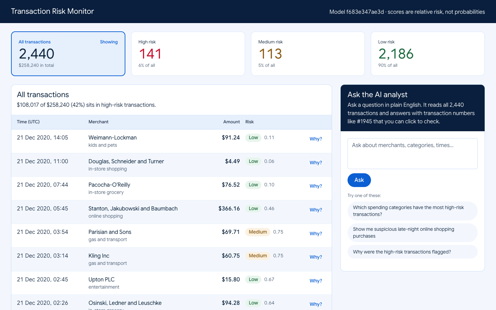

# Transaction Risk Platform

[](https://github.com/krishitag/TransactionTracker/actions/workflows/ci.yml)

Card-transaction risk scoring that **explains every score in plain English**, plus an **AI analyst** that
answers questions about the transactions and cites the exact transactions it used, each one checked in code.



**Live demo:** **[transaction-risk-monitor.vercel.app](https://transaction-risk-monitor.vercel.app)** · API: [transaction-risk-api-4g3d.onrender.com/docs](https://transaction-risk-api-4g3d.onrender.com/docs)
*Free hosting: if nobody has visited for a while, the backend takes about a minute to wake up. The page says so and fills in by itself.*
**Results:** [RESULTS.md](RESULTS.md), the model's numbers, the AI answers checked against SQL, and the known blind spots.

> Built on **simulated** data with a deliberately simple, interpretable model. A portfolio project, not a
> production fraud system.

## What it does

- **Scores each payment** as it arrives (High ≥ 0.9, Medium ≥ 0.7, Low) and stores the score with the model version that produced it.
- **Says why:** *"Amount $1,034.66 is about 15x the typical transaction ($70)"*, *"Made at 22:09, in the 22:00-04:00 window when most fraud happens"*, *"First time this card has paid Price Inc"*.
- **Answers questions** like *"Show me suspicious late-night online shopping purchases"* with real counts and clickable transaction numbers. Made-up citations are stripped, and questions the data can't answer are declined.
- **Dashboard:** stat cards that double as filters, a transaction table with reasons on demand, and the AI panel.

## Key results

| | |
|---|---|
| PR-AUC on the held-out test set | **0.285**, vs 0.0058 random (fraud is 0.58% of transactions) |
| High-risk band (≥ 0.9) | 32.9% precision, 59.8% recall |
| Adding a night-time feature (found by asking the AI layer about the data) | PR-AUC +36%, alerts −22%, recall 53% → 60% |
| Demo database | 141 flagged High, 126 of them real fraud (89%) |
| AI answers checked against SQL | every statistic and citation correct; trap questions declined |

Full tables, the v1 → v2 comparison and the limitations are in **[RESULTS.md](RESULTS.md)**.

## Architecture

Deployed as: **Vercel** (dashboard) → **Render**, Singapore (FastAPI in Docker) → **Neon**, Singapore (Postgres + pgvector), with Gemini for answers. Render auto-deploys only after GitHub Actions CI passes.

```
Next.js dashboard ──fetch──▶ FastAPI ──▶ Postgres 16 + pgvector
                               │
                               ├─ scoring.py     LogisticRegression + plain-English reasons
                               ├─ embeddings.py  all-MiniLM-L6-v2 (384-dim) summaries of each transaction
                               └─ ask.py         keyword filters + vector search + SQL statistics
                                                 → Gemini (default) or Claude → citation check
```

- **One database transaction per payment:** insert, score, embed and store happen together, so a payment is never left unscored.
- **Hybrid retrieval for questions:** embeddings find relevant examples, and SQL supplies exact counts, because embeddings can't count.
- **Safety:** data is fenced off from instructions in the prompt (prompt-injection defence), the `/ask` session is read-only, every cited ID is verified, and every external call has a timeout.
- **Privacy:** the API only ever returns the last 4 card digits.

## Tech stack

**Backend:** Python 3.12, FastAPI, scikit-learn, pandas, sentence-transformers, psycopg2 ·
**Database:** PostgreSQL 16 + pgvector (HNSW index) · **AI:** Google Gemini (free tier) or Anthropic Claude,
switchable by one setting · **Frontend:** Next.js 16, React 19, TypeScript, Tailwind CSS 4 ·
**Quality:** pytest (43 tests), ruff, ESLint, GitHub Actions

## Dataset

[**Credit Card Transactions Fraud Detection Dataset**](https://www.kaggle.com/datasets/kartik2112/fraud-detection)
by Kartik Shenoy on Kaggle (CC0 Public Domain). It is simulated data generated with the
[Sparkov data generator](https://github.com/namebrandon/Sparkov_Data_Generation): about 1.3M training
transactions (`fraudTrain.csv`) and 556K test transactions (`fraudTest.csv`) with card, merchant, category,
amount, time and locations, each labelled fraud or not.

The CSVs are too large for GitHub, so download them from the link above into `data/`. CI uses a small
committed sample instead (`backend/tests/data/sample.csv`).

## Run it locally

Needs Docker, Python 3.12 and Node 22.

```bash
# 1. Database (Postgres + pgvector on port 5433)
docker compose up -d

# 2. Backend
cd backend
python3.12 -m venv venv
venv/bin/pip install -r requirements.txt
cp .env.example .env              # then add your free Gemini key from https://aistudio.google.com
venv/bin/uvicorn main:app         # http://localhost:8000/docs; first start takes ~30s (embedding model)

# 3. Load demo data (needs data/fraudTest.csv), in a second terminal from backend/
venv/bin/python seed_transactions.py

# 4. Dashboard, in a third terminal
cd frontend
npm install
npm run dev                       # http://localhost:3100
```

The trained model (`backend/models/risk_model.joblib`) is committed. To retrain, run
`venv/bin/python train_model.py` with `data/fraudTrain.csv` present.

**Tests:** from `backend/`, `venv/bin/pip install -r requirements-dev.txt`, then `venv/bin/python -m pytest`
and `venv/bin/ruff check .`. They need no database, network or API keys.

## Project docs

- [RESULTS.md](RESULTS.md): measured results and limitations
- [PROJECT_JOURNAL.md](PROJECT_JOURNAL.md): every decision, with what / why, in plain language
- [STATUS.md](STATUS.md): progress, backlog and change log
- [DESIGN.md](DESIGN.md): the design system the dashboard follows

## Limitations

Simulated data; a five-feature logistic regression chosen for explainability over raw accuracy; small-value
fraud (likely card testing) and daytime fraud are the main blind spots; free-tier LLM limits. Details and
next steps are in [RESULTS.md](RESULTS.md#known-limitations-and-blind-spots).
